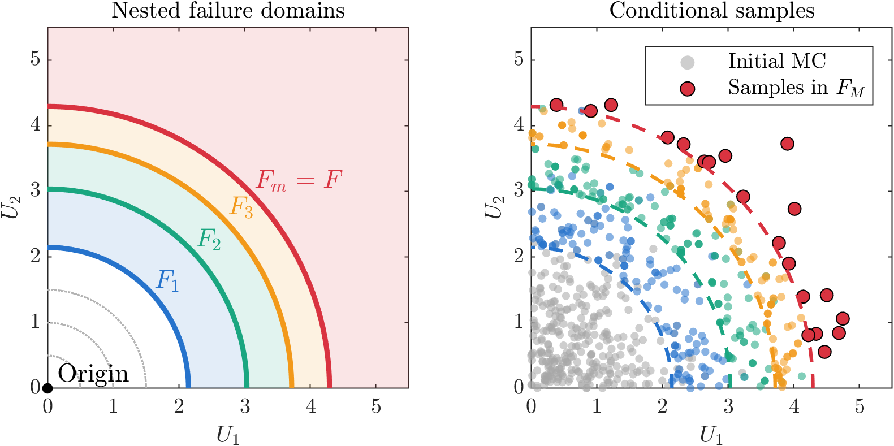

Various sampling methods have been developed to calculate the failure probability of structural systems. While the Monte Carlo simulation (MCS) is a widely accepted robust methodology to perform structural reliability analysis, this procedure suffers from computational efficiency when evaluating the limit state function is costly because the number of samples ($n_s$) needed to achieve a desired coefficient of variation ($\delta$) of the probability failure estimate ($P_f$) is $\delta = \sqrt{ \frac{1-P_f}{n_s \cdot P_f} }$. Thus, as the expected failure probability is low the required number of samples needed to have a low c.o.v. becomes high. One of the alternatives of MCS, namely, the *subset simulation* is discussed in this post. The description and notation provided here follows the work of Papaioannou et al. (2015).

## Subset simulation

The subset simulation (SS) was first proposed by Au and Beck (2001) to estimate failure probabilities in high dimensional problems. The main idea: instead of calculating the failure probability using large number of samples (i.e. MCS), the probability estimate is formulated as a product of several conditional failure probabilities each requiring smaller number of samples to calculate. Conceptually, this means the original failure domain $F$ is represented as an intersection of overlapping events: $F=\cap_{j=1}^{M} F_j$. The failure probability $P_f$ is expressed as

$$
P_f = \Pr(F) = \Pr(\cap_{j=1}^{M} F_j) = \prod_{j=1}^{M} \Pr(F_j | F_{j-1})
$$

An illustration of these nested failure events is shown below (with three levels). These intermediate events are chosen such that $\Pr(F_j | F_{j-1}$ is relatively large, allowing estimation with only small number of samples. The next key step is to generate samples conditional from these intermediate failure events until the original failure domain is reached. Variations of SS

	

## Algorithm

## Example

## Reference

[1] Au, S.-K., & Beck, J. L. (2001). Estimation of small failure probabilities in high dimensions by subset simulation. Probabilistic Engineering Mechanics, 16(4), 263–277. [https://doi.org/10.1016/s0266-8920(01)00019-4](https://doi.org/10.1016/s0266-8920(01)00019-4){.uri}

[2] Papaioannou, I., Betz, W., Zwirglmaier, K., & Straub, D. (2015). MCMC algorithms for Subset Simulation. Probabilistic Engineering Mechanics, 41, 89–103. <https://doi.org/10.1016/j.probengmech.2015.06.006>
